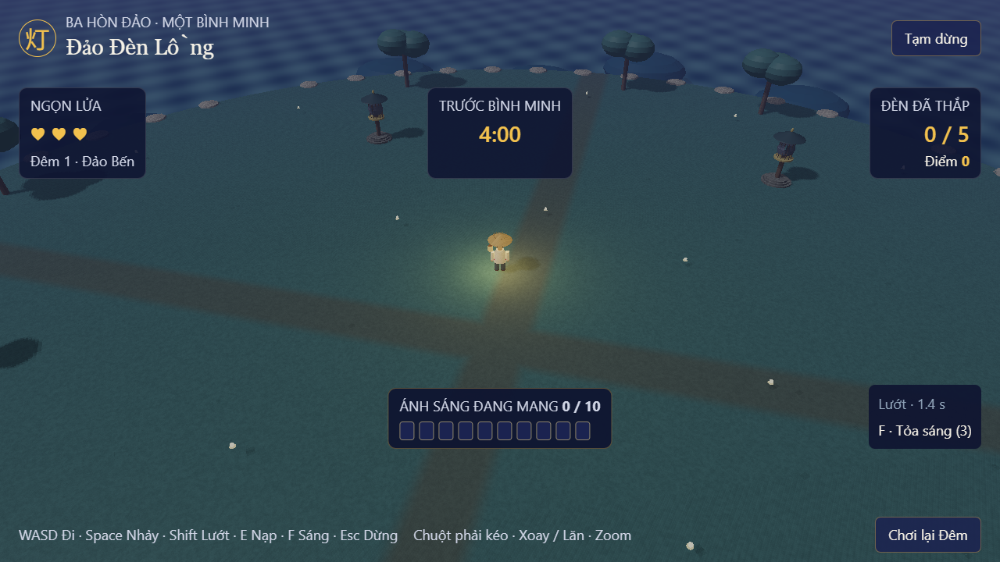

# Đảo Đèn Lồng · v1.0.0

Game 3D WebGL: Mây gom đom đóm, thắp và châm dầu để giữ **3/5 · 4/6 · 5/7 đèn** sáng tới bình minh qua ba Đêm. Contract **1.3**, logic cố định 60 Hz dùng chung web/headless.



## Cài đặt

Cần **Node.js 22+**, trình duyệt WebGL, bàn phím/chuột. Không cần npm install, CDN hay mạng khi chơi. Đã kiểm tra Windows 11 / Node24 / Chrome157 / Intel Iris Xe; chưa thử trực tiếp macOS/Linux.

Từ máy có Git và Node, tối đa ba lệnh:

```sh
git clone https://github.com/VUDUCTHANG130604/K5-L3A-DAY12-VuDucThang-2A202603601-AI-SDLC-Dao-Den-Long.git
cd K5-L3A-DAY12-VuDucThang-2A202603601-AI-SDLC-Dao-Den-Long
node scripts/serve.mjs
```

Mở **http://localhost:3000**. Với ZIP Release: giải nén, vào `dao-den-long-v1.0.0`, chạy lệnh cuối. Gói cần Node. Dừng bằng Ctrl+C; biến `PORT` đổi cổng; server mặc định chỉ nghe loopback. Chưa hỗ trợ cảm ứng.

| Mặc định | Hành động |
| --- | --- |
| WASD / mũi tên | Di chuyển theo camera |
| Space / Shift | Nhảy / lướt |
| E / F | Nạp hoặc châm dầu / Tỏa Sáng |
| Esc / P | Tạm dừng |
| Kéo chuột phải / lăn | Xoay / zoom |

Cài đặt cho đổi cả 9 phím, báo trùng, khôi phục mặc định; lưu âm lượng, độ nhạy, màu dễ phân biệt, giảm chuyển động và chữ lớn ×1.25. Chữ tối thiểu 18 px ở 1280×720. Có chỉ báo Bóng Mực xuất hiện kèm hướng, gió sắp thổi, 10 giây cuối và dầu thấp. Giảm chuyển động bỏ hiệu ứng trang trí; cảnh báo dầu 1 Hz vẫn giữ.

Sau thua hoặc thắng Đêm3, nhập tên ASCII 3–12 ký tự `[A-Za-z0-9_]`. Bảng xếp hạng giữ top10 tổng điểm các Đêm **đã thắng**, điểm giảm dần rồi thời điểm sớm. Lưu ở `.data/leaderboard.json`, đổi nơi bằng `DAO_DATA_DIR`. Sao lưu thư mục này khi thay bản. Không mở trực tiếp HTML vì lưu đĩa cần server Node.

```sh
node scripts/serve.mjs --export-leaderboard out.json
```

## Kiểm chứng

```sh
node scripts/verify.mjs
node scripts/browser-smoke.mjs
node scripts/headless.mjs --seed 12 --night 1 --inputs tests/scenarios/phase3-win.inputs.json --ticks 14400 --out dawn.jsonl
node scripts/bench.mjs --seed 42 --duration 30 --out bench.json
node --expose-gc --max-semi-space-size=1 scripts/soak.mjs --seed 7 --nights 10 --out soak.json
node scripts/package.mjs
```

Verify chạy78 test và33 fixture qua hai process, so từng byte và toàn bộ JSONL với Phase3. Replay mặc định thắng bình minh ở14400tick,1102điểm. Browser QA tự mở server tạm, cần Chrome (hoặc truyền đường dẫn executable), kiểm tra đổi phím, reload, chữ, thua bằng input, lưu điểm và export. Chưa có test ẩn giảng viên để chạy.

Bench cần Chrome/Chromium; đặt `CHROME_BIN` nếu không tự tìm được. Cửa sổ không toàn màn hình, viewport1280×720, yêu cầu tắt vsync bằng `--disable-frame-rate-limit --disable-gpu-vsync`; driver/compositor có thể vẫn giới hạn. Warmup3s rồi đo đúng thời lượng:200 shade wander,100 đom đóm,L1–L3 dầu100, ánh sáng/shadow thật. `peak_mem_mb: null` vì web tách nhiều process, không có API RSS toàn bộ cây trình duyệt tin cậy. `load_ms` từ process Node tới khung đầu hoàn tất GL. `BENCH_HEADLESS=1` chỉ dành chẩn đoán.

Máy tham khảo: **125,4FPS**, 1% thấp nhất **66,6FPS**, tải **1189,6ms**. Máy giảng viên mới quyết định đạt ngưỡng. Soak dùng seed7+i với i bắt đầu0, input độc lập mỗi Đêm, cùng process, không giữ lịch sử. Cờ V8 giới hạn young heap và GC tại reset để so RSS; không tăng baseline giả. Kết quả:0crash,RSS tăng khoảng6%, giới hạn20%.

Gói: `dist/dao-den-long-v1.0.0.zip`, kèm `SHA256SUMS.txt`; cần PowerShell Compress-Archive trên Windows hoặc zip trên Linux/macOS. [Video](docs/demo/demo.mp4), [bằng chứng](docs/proof/phase-4/README.md), [spec và AC](docs/notes/phase-4.md), [retro](docs/RETROSPECTIVE.md), [contract](docs/TEST-CONTRACT.md), [changelog](CHANGELOG.md), [credits](CREDITS.md), [license](LICENSE).

## Luật và lịch sử

Giữ luật Phase3: dầu100 hao1/s, dưới30 mất vùng an toàn; Bóng Mực hút5/s/con, thắp lại5đốm, túi tăng tới20, xét thắng ở bình minh240/270/300s. [ADR](docs/adr/0001-lantern-fuel-and-dawn.md). Phase4 giữ nguyên đầu ra gameplay. Proof cũ giữ nguyên. Phase1 không có tag riêng trong lịch sử hiện hữu; không tạo ngược một tag giả.
