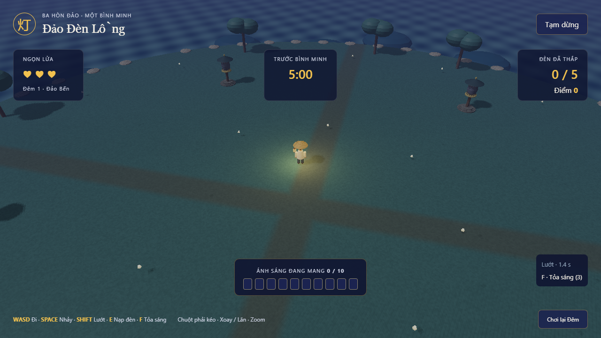

# Đảo Đèn Lồng — Phase 2 · Ba hòn đảo

Game 3D WebGL: Mây đội nón lá treo đèn, chạy qua **Đảo Bến → Đảo Cau → Đảo Chuông**, gom đom đóm và thắp 5/6/7 đèn trước bình minh. Có lướt, bục nhảy, cầu tre, tầng cao/dốc, gió mạnh, Gió Lạc cướp đốm, Bùa Gió, âm thanh và tổng điểm hành trình.

Triển khai theo **Test Contract v1.1**. Browser và headless dùng chung mô phỏng 60 Hz; [game.contract.json](game.contract.json) khai báo đúng số chuẩn. [Spec và acceptance criteria](docs/notes/phase-2.md), [bằng chứng](docs/proof/phase-2/README.md). Bộ test ẩn của giảng viên chưa được cung cấp/chạy.



## Cài và chạy

Cần **Node.js 20+**, trình duyệt có WebGL và bàn phím. Không dependency/CDN. Từ repo chạy hai lệnh:

```sh
node scripts/build.mjs
node scripts/serve.mjs
```

Mở **http://localhost:3000**, chọn **Hành trình mới**, đọc lời Ông Đăng và **Bắt đầu Đêm**. Thắng để tới Đêm sau; thua được chơi lại Đêm đó. Thắng Đêm 3 hiện Bình Minh với tổng điểm các Đêm đã thắng. Âm thanh được mở sau thao tác người dùng.

| Điều khiển | Thao tác |
| --- | --- |
| WASD / mũi tên | Đi theo camera, cả trên không |
| Space | Nhảy khi chạm đất |
| Shift | Lướt theo hướng di chuyển, hoặc hướng đang quay mặt |
| E | Nạp vào một đèn chưa sáng gần nhất (có thể nạp nhiều lần) |
| F | Tỏa Sáng, tốn 3 đốm, choáng/đẩy Bóng Mực; xua Gió Lạc hoặc lấy lại đồ cướp |
| Chuột phải kéo / lăn | Xoay camera / zoom |
| Esc / P | Pause: tiếp tục, chơi lại Đêm, cài đặt, về menu |

Túi tối đa **10**, đèn cần **10**; tốc độ chạy **6 m/s**, lướt **14 m/s / 0.2 s / hồi 1.5 s**. Mỗi Đêm bắt đầu 3 Ngọn Lửa, thời lượng **300/330/360 s**. Rơi khỏi đảo mất 1 Ngọn Lửa và toàn bộ túi; hồi sinh sau 1 s nếu còn sống. Gió Lạc không gây mất máu. Bùa Gió tăng tốc lên 7.2 m/s, bỏ hồi lướt trong 10 s. Cài đặt âm lượng/độ nhạy lưu qua lần mở lại. Mất focus tự pause; chưa có điều khiển cảm ứng.

## Điểm chuẩn

**+10/đốm nạp**, **+100/đèn sáng**, **+5/shade trúng mỗi pulse**, kể cả shade đang choáng. Nhặt đốm không cho điểm. Khi thắng thưởng **floor(giây còn lại) × 2 + Ngọn Lửa × 50**. Tổng hành trình chỉ cộng điểm các Đêm thắng; thua/chơi lại không nhân đôi điểm.

## Headless và kiểm chứng

```sh
node scripts/headless.mjs --seed 12 --night 3 --ticks 21600 --out night3.jsonl
```

Hỗ trợ `--night 1|2|3`, `--scenario`, `--inputs`, `--snapshot-every` (mặc định10), output snapshot/event/end JSONL. Không cửa sổ/GPU/mạng. Input/scenario sai định dạng → exit2; lỗi vận hành → exit1; lượt hợp lệ kể cả lost → exit0. Schema, timer và chỗ ticket để mở được ghi trong [TEST-CONTRACT.md](docs/TEST-CONTRACT.md).

Chạy **`node scripts/verify.mjs`**: build/tuning, tất cả test, tái tạo replay Đêm 1 mặc định bằng input hợp lệ, CLI từng tính năng hai lần để so từng byte, đo thời gian headless 3 Đêm. Replay mặc định hiện thắng seed **10**, tick **17034**, **3 Ngọn Lửa**, **1272 điểm**. Tái tạo bằng `--seed 10 --night 1 --inputs tests/scenarios/win.inputs.json --ticks 18000 --out win.jsonl`.

Kiểm tra browser tùy chọn, cần Node22+ và Chrome/Chromium: mở server rồi chạy `node scripts/browser-smoke.mjs` (hoặc thêm đường dẫn trình duyệt). QA dùng **đường GPU thường**, 1280×720, ghi FPS thực; `QA_SOFTWARE=1` là fallback có gắn nhãn. Kết quả đã đo: khoảng **52.5 FPS** trên Intel Iris Xe, vượt 30 FPS; không suy ra hiệu năng trên mọi máy. Xem báo cáo để biết thời điểm và cấu hình.

## Sáng tạo của tôi

Giữ mô hình Mây có tay chân, áo, dép, nón lá treo đèn; đèn có nan, mái và bệ đá. Mây thấp, cỏ, đá và cây được tạo bằng hình học; shadow map/nguồn sáng đèn, lá báo gió và nhạc/hiệu ứng tổng hợp Web Audio tạo không khí cổ tích đêm. Palette albedo dùng đúng bảng chuẩn, ambient `0.15+0.55×lit/count`. Hiệu ứng trang trí ở renderer/audio, không thêm thực thể làm đổi headless. [Ảnh ba bản đồ](docs/proof/phase-2/README.md) và JSONL chứng minh phần lõi vẫn chạy.

## Bàn giao và giới hạn

`src/` chứa mô phỏng/bản đồ/campaign; `web/` dựng hình/HUD/cài đặt/audio; `scripts/`, `tests/` chứa harness/scenario. [AGENTS.md](AGENTS.md) và [skill kiểm chứng](skills/phase2-contract/SKILL.md) hướng dẫn duy trì. Tài liệu và bằng chứng Phase 1 được giữ như lịch sử; số cân bằng Phase 1 đã được thay bằng số chuẩn Phase 2.

Đã kiểm chứng Windows/Chrome; headless dùng Node chuẩn, có CI Ubuntu, chưa chạy trực tiếp macOS/Linux hay CI từ GitHub trong phiên. Chưa chơi thủ công toàn bộ 3 Đêm, chưa nghe thử âm thanh bằng người đánh giá độc lập và chưa có bộ chấm ẩn. Các fixture thắng được dựng scenario được ghi rõ, tách với replay thế giới mặc định. [Nguồn](CREDITS.md), [giấy phép mã mới](LICENSE); tài liệu lab giữ quyền tác giả.
