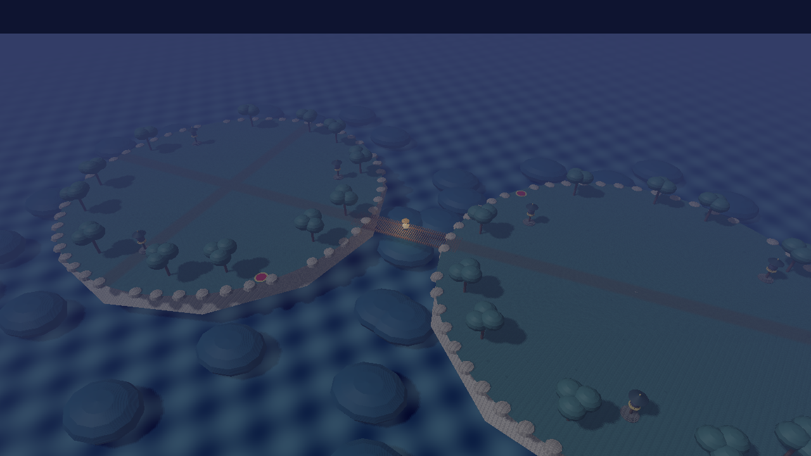
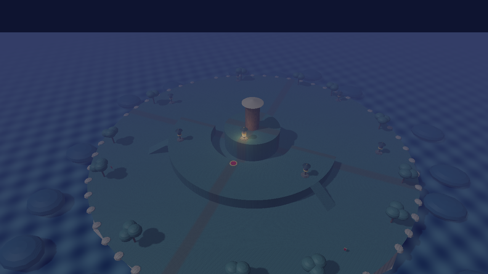

# Bằng chứng Phase 2 · v1.1

Tái tạo backend: `node scripts/verify.mjs`. Browser: mở server rồi `node scripts/browser-smoke.mjs` (Node22+, Chrome). Báo cáo sinh từ lệnh thật, không sửa output để pass. Phase1 proof là lịch sử riêng, không đại diện số chuẩn hiện tại.

| Nội dung | Bằng chứng |
| --- | --- |
| 42 unit/CLI/regression/campaign/map/settings tests | `tests.txt` |
| Tuning manifest khớp, JSONL deterministic qua process riêng | `verification.json`, từng `*.jsonl` |
| Dash / pause / fall / pad2 / pad3 / ramp | `dash`, `pause`, `fall`, `pad2`, `pad3`, `ramp` JSONL |
| Drifter theft và pulse trả đồ / charm / wind | `drifter`, `drifter-drop`, `charm`, `wind` JSONL |
| Spawn schedule | Unit tests, `spawn.jsonl` (lượt này thua ở tick856, không tuyên bố sống tới1200) |
| Timeout đủ3Đêm ≤30s | `timeout-1/2/3.jsonl`, `verification.json` ghi thời gian thực hai process mỗi Đêm |
| Win terminal mỗi Đêm từ scenario pre-lit | `win-1/2/3.jsonl` (win tick1, chỉ kiểm tra kết thúc, không phải chơi full màn) |
| Win thế giới mặc định bằng input thực | `default-win.jsonl`, seed10,17034tick,3flames,1272điểm; input tại `tests/scenarios/win.inputs.json` |
| Menu/intro/input/pause/retry/settings/reload, khôngJSerror | `browser.json` |
| FPS native1280×720 đườngGPU thường | `browser.json`: Intel Iris Xe, khoảng52.5FPS, sample10s |
| Hình ảnh game và settings | `menu.png`, `night-intro.png`, `gameplay.png`, `pause-menu.png`, `settings.png`, `narrow-layout.png` |
| Cả3bản đồ chuẩn trong canvasQA riêng | `map-1.png`, `map-2.png`, `map-3.png` |

Mỗi fixture có `<name>.scenario.json`, `<name>.inputs.json`. Dùng seed/night/ticks trong verification để tái tạo vớiCLI. Default-win phải dùng seed10, các fixture khác seed12. `tests/phase2-fixtures.mjs` là bộ định nghĩa fixture. Chưa có hidden tests, full campaign chơi tay, nghe thử audio thủ công hay CI/macOS/Linux thực chạy.
