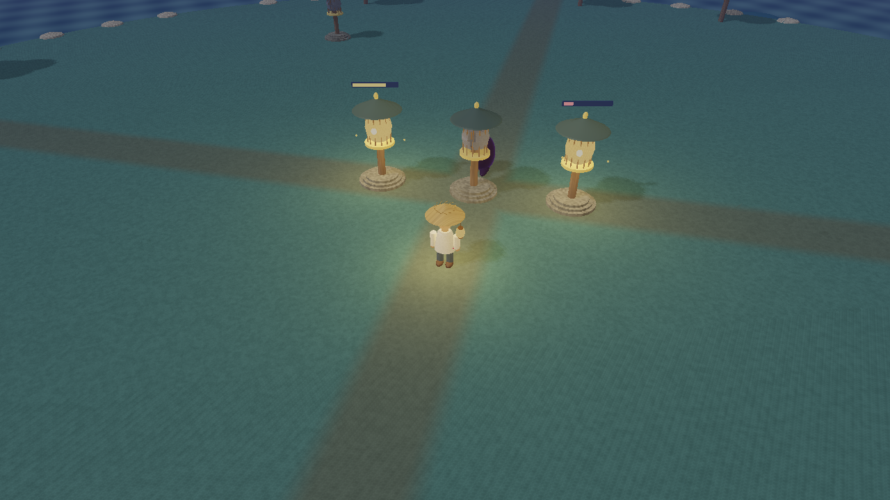
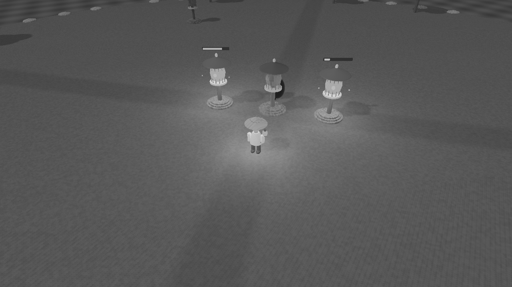

# Bằng chứng Phase 3 · v1.2

Tái tạo: `node scripts/verify.mjs`. Giao diện: mở server rồi `node scripts/browser-smoke.mjs` (Node22+ và Chrome). Output từ lệnh thật; không sửa JSONL/báo cáo để đạt. Phase1/2 proof là lịch sử, không được ghi đè.

| Tiêu chí | Bằng chứng |
| --- | --- |
| Unit/regression/schema/settings/palette, khôngskip | `tests.txt` |
| Exact decay6000tick, pause, receiver/refuel/ceil | `fuel-expiry`, `fuel-pause`, `refuel` JSONL và unit |
| Thắp lại5, lặp2lần, cap16 sau3success | `relight`, `relight-cycle` JSONL |
| Cộng hút dầu, event60tick, pulse15, phục hồi safe | `drain-stack`, `drain-pulse`, `safe-restore` JSONL |
| Không sớm, cuối tick out/relight, ngưỡng3Đêm | `no-early-win`, `dawn-extinguish`, `dawn-final-relight`, `win-*`, `threshold-lost-*` |
| Đầy đủ14400/16200/18000tick và thời gian CLI | `timeout-*`, `verification.json` |
| Replay default-world sống tới bình minh | `default-win.jsonl`: seed12,14400tick,3lit,2flames,1102điểm; inputs mới ở `tests/scenarios/phase3-win.inputs.json` |
| Campaign/retry chỉ cộng điểmĐêm thắng | `campaign.json` (điểm từ CLI fixturespre-lit, không giảdefaultcampaign) |
| Hai process CLI cho mỗi fixture giống từngbyte | `verification.json`, input/scenario cạnh từngJSONL |
| Settings mùmàu/reload, warningwhite, bar1Hzpixel | `browser.json`, `settings.png`, `fuel-states-accessible.png`, `fuel-states-dim.png` |
| Không dùng màu vẫn phân biệt off/lit | `fuel-states-monochrome.png` (rendergrayscale trong QAcanvas) |
| FPS1280×720 đườngGPUthường, input/menu/pause | `browser.json`, `gameplay.png`, ảnh desktop/hẹp |

JSONL mỗi fixture tái tạo bằng các file `<name>.scenario.json` và `<name>.inputs.json`, seed/night/ticks tại verification. Default-win seed12 như các fixture hiện tại; xem report nếu đổicontroller sau này. Ảnh ba trạng thái và bản đồ ở canvasQA riêng, không phải thắng thủ công. Bộ test ẩn, macOS/Linux thực tế và full campaign chơi tay chưa chạy.
